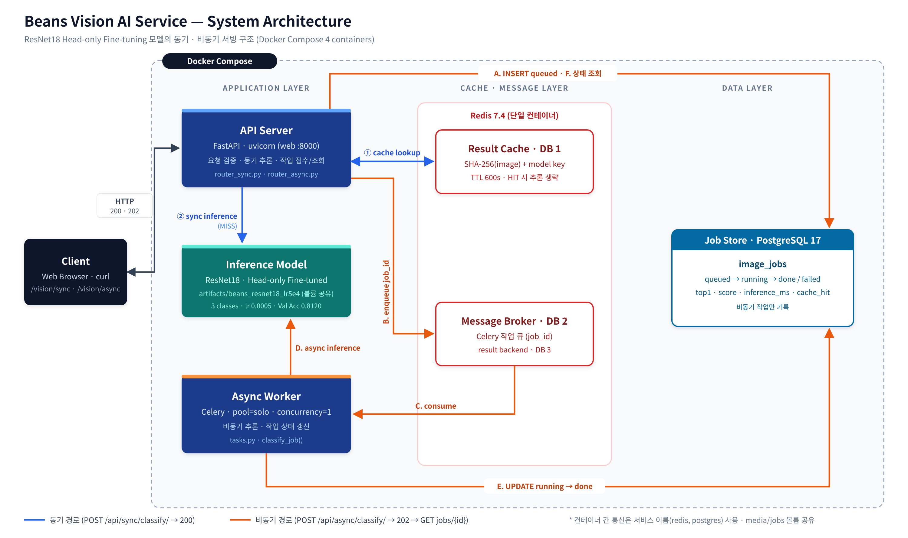
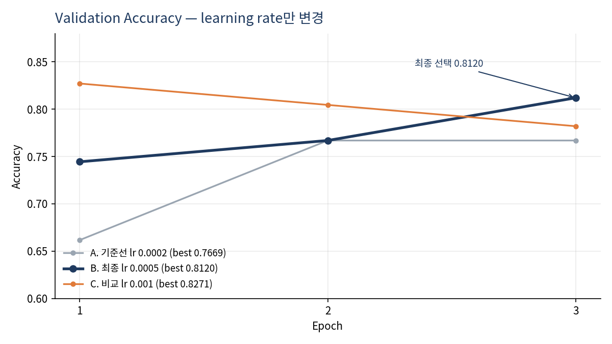
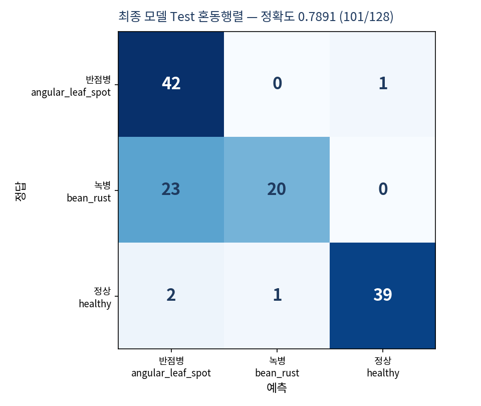

# Beans Leaf Disease Classifier — ResNet18 · FastAPI Sync/Async Serving

콩잎 이미지를 **반점병(`angular_leaf_spot`) · 녹병(`bean_rust`) · 정상(`healthy`)** 3클래스로 분류하는 Vision AI 서비스입니다.
사전학습 ResNet18을 Fine-tuning하고, FastAPI **동기 API**와 Celery·Redis·PostgreSQL 기반 **비동기 작업 큐**로 서빙합니다.

> 교과 9 통합 평가 프로젝트 · 모든 수치는 실제 실행 결과이며 근거는 `reports/`에 있습니다.

---

## Highlights

| 구분                  | 결과                                                                                      |
| ------------------- | --------------------------------------------------------------------------------------- |
| 최종 모델               | ResNet18 Head-only Fine-tuning, learning rate 0.0005 (`artifacts/beans_resnet18_lr5e4`) |
| Validation Accuracy | 기준선 0.7669 → **0.8120** (+4.51%p, learning rate만 변경)                                    |
| **Test Accuracy**   | **0.7891** (101/128, 최종 모델 1회 측정)                                                       |
| 병든 잎 → 정상 오판        | **1 / 86**                                                                              |
| 주요 약점               | 녹병 → 반점병 혼동 23 / 43 (bean_rust recall 0.4651)                                           |
| 캐시 효과 (동기)          | 24.6 ms → **2.2 ms** (−91.06%)                                                          |
| 비동기 접수 응답           | 8.8 ms (동기 대비 −64.23%) · 결과 확인 214.6 ms                                                 |
| 테스트                 | 실환경 통합 T-01~T-10 PASS · 모의 테스트 4 passed                                                 |

---

## Architecture



| 경로  | 흐름                                                                                                                  | 응답               |
| --- | ------------------------------------------------------------------------------------------------------------------- | ---------------- |
| 동기  | Client → FastAPI → Redis Cache(DB1) → ResNet18 → JSON                                                               | `200` + 결과       |
| 비동기 | Client → FastAPI → PostgreSQL(`queued`) → Redis Broker(DB2) → Celery Worker → ResNet18 → PostgreSQL(`done`) → 상태 조회 | `202` + `job_id` |

- 캐시 키: `SHA-256(이미지) + 모델 식별자`, TTL 600초 — HIT 시 추론 생략 (`inference_ms: null`)
- web·worker는 같은 이미지로 빌드된 별도 컨테이너이며, `artifacts/`·`media/jobs/`를 볼륨으로 공유

## Tech Stack

| 영역 | 사용 기술 |
|---|---|
| Model | PyTorch, Hugging Face Transformers, `microsoft/resnet-18` |
| API | FastAPI, Uvicorn |
| Async | Celery (`pool=solo`, `concurrency=1`), Redis 7.4 |
| Database | PostgreSQL 17, SQLAlchemy |
| Infra | Docker Compose (web · worker · redis · postgres), WSL2 Ubuntu |
| Data | Hugging Face `AI-Lab-Makerere/beans` |

---

## Model Development

### 1. Baseline — Head-only Fine-tuning
Backbone을 고정하고 새 분류층(전체 11,178,051개 중 **1,539개**)만 학습했습니다.

| Epoch | Train Loss | Val Loss | Val Acc |
|---:|---:|---:|---:|
| 1 | 0.9924 | 0.8379 | 0.6617 |
| 2 | 0.8108 | 0.6868 | 0.7669 |
| 3 | 0.7078 | 0.5911 | 0.7669 |

**진단:** 마지막 epoch까지 train·val loss가 계속 감소(평평해지지 않음)하고 val loss 상승이 없어 과적합이 아닌 **학습 부족**. 원인 후보는 learning rate(업데이트 크기)와 epoch(학습 횟수)인데 loss 곡선만으로는 구분할 수 없어, **같은 학습 시간을 유지한 채 learning rate만 바꿔** 확인하고 epoch 조정은 다음 실험으로 남김.

### 2. Improvement — learning rate만 변경
epochs 3 · batch 8 · Head-only · seed 42를 고정하고 `--lr`만 바꿔 **Validation으로만** 비교했습니다.

| 실험 | lr | Val Acc (epoch 1 → 2 → 3) | Best Val |
|---|---:|---|---:|
| A. 기준선 | 0.0002 | 0.6617 → 0.7669 → 0.7669 | 0.7669 |
| **B. 최종** | **0.0005** | 0.7444 → 0.7669 → **0.8120** | **0.8120** |
| C. 비교 | 0.001 | 0.8271 → 0.8045 → 0.7820 | 0.8271 |

**선택 근거:** C는 최고값이 가장 높지만 epoch 1 이후 계속 하락(불안정). B는 매 epoch 상승하고 train·val loss도 함께 감소. 두 값의 차이가 133장 중 2장이므로 **안정적인 B를 선택**.



### 3. Final Evaluation — Test 1회
| split | Accuracy |
|---|---:|
| train | 0.8066 (834/1,034) |
| val | 0.8120 (108/133) |
| **test** | **0.7891 (101/128)** |



---

## Quick Start

### Requirements
- Windows + WSL2 Ubuntu, Docker Desktop (WSL Integration 활성화)
- Python 가상환경 `.venv` (학습·평가용)

### 1) Data
```bash
mkdir -p ~/beans_source && cd ~/beans_source
for f in train validation test; do
  wget https://huggingface.co/datasets/AI-Lab-Makerere/beans/resolve/main/data/$f.zip
done
unzip -q train.zip && unzip -q validation.zip && unzip -q test.zip

cd ~/fastapi_resnet18
mkdir -p dataset/{train,val,test}
cp -r ~/beans_source/train/*      dataset/train/
cp -r ~/beans_source/validation/* dataset/val/     # 코드가 dataset/val을 읽음
cp -r ~/beans_source/test/*       dataset/test/
rm -f dataset/train/healthy/healthy_train.120tore  # 이미지가 아닌 파일 1개 제거
```
결과: train 1,034 / val 133 / test 128 (split 간 SHA-256 완전 중복 0건)

### 2) Train
```bash
python3 -m venv .venv && source .venv/bin/activate
python -m pip install -r requirements.txt

# 기준선
python -m training.finetune --data dataset --output artifacts/beans_resnet18 \
  --epochs 3 --batch-size 8 --freeze-backbone
# 최종 모델 (learning rate만 변경)
python -m training.finetune --data dataset --output artifacts/beans_resnet18_lr5e4 \
  --epochs 3 --batch-size 8 --lr 0.0005 --freeze-backbone
```

### 3) Run
```bash
cp .env.example .env        # MODEL_PATH=artifacts/beans_resnet18_lr5e4
docker compose up -d --build
docker compose ps           # 4개 Up, web (healthy)
curl http://127.0.0.1:8000/health
```

| 화면 / 문서 | URL |
|---|---|
| 동기 분류 | http://127.0.0.1:8000/vision/sync/ |
| 비동기 분류 | http://127.0.0.1:8000/vision/async/ |
| Swagger | http://127.0.0.1:8000/docs |

- `.env`·모델 변경 후: `docker compose up -d --force-recreate web worker`
- 정지: `docker compose stop` — `docker compose down -v`는 DB 데이터까지 삭제하므로 주의

---

## API

| Method | Endpoint | 성공 | 실패 | 설명 |
|---|---|---:|---|---|
| GET | `/health` | 200 | — | 서버 상태 |
| POST | `/api/sync/classify/` | 200 | 400 · 413 | 즉시 분류 결과 반환 |
| POST | `/api/async/classify/` | 202 | 400 · 413 · 503 | 작업 접수, `job_id` 반환 |
| GET | `/api/async/jobs/{job_id}/` | 200 | 404 | `queued → running → done / failed` |

입력: JPEG · PNG · WEBP, 5MB 이하 · 상세 명세: [03_API_명세서](reports/03_API_명세서.md)

---

## Reproduce Measurements

| 목적 | 명령 | 출력 |
|---|---|---|
| Validation Loss 기록 | `PYTHONPATH=. python reports/val_loss_log.py --epochs 3 --lr 0.0005 --out reports/data/loss_history_lr5e4.json` | `reports/data/loss_history_*.json` |
| 최종 모델 평가 (Test 1회) | `python reports/evaluate.py artifacts/beans_resnet18_lr5e4` | `reports/data/eval_beans_resnet18_lr5e4.json` |
| 응답시간 측정 | `python reports/measure.py dataset/test/bean_rust/bean_rust_test.0.jpg` | `reports/data/timings.csv` |
| 그래프 | `python reports/plot_curves.py` · `python reports/plot_test.py` | `reports/figures/` |
| 모의 테스트 | `docker compose exec web python -m pytest -q tests/test_api.py` | 4 passed |

`reports/`의 스크립트는 측정 보조 도구이며, 제공 코드(`ai/`, `training/`, `main.py`, `templates/`)는 수정하지 않았습니다.

---

## Documentation

| No. | 문서 | 내용 |
|---|---|---|
| 01 | [Fine-tuning 결과보고서](reports/01_FineTuning_결과보고서.md) | 데이터 분리, 학습·Loss 기록, 개선 실험, Test 평가 |
| 02 | [시스템 아키텍처](reports/02_시스템_아키텍처.md) | 컨테이너 구성, 컴포넌트 역할, 실행 환경 |
| 03 | [API 명세서](reports/03_API_명세서.md) | 엔드포인트, 요청·응답 JSON, 상태코드 |
| 04 | [DB 구조·작업이력](reports/04_DB_구조_작업이력.md) | `image_jobs` 스키마, 상태 전이 |
| 05 | [AI 버튼 처리흐름](reports/05_AI버튼_처리흐름.md) | 동기·비동기 시퀀스, 코드 연결표 |
| 06 | [성능비교 보고서](reports/06_성능비교_보고서.md) | HTTP·최종·추론·캐시 시간 비교 |
| 07 | [기능테스트·오류분석](reports/07_기능테스트_오류분석.md) | 통합·모의 테스트, 오류 조치 이력 |
| 08 | [최종 기술보고서](reports/08_최종기술보고서.md) | 전체 종합, 의사결정, 한계와 다음 단계 |

## Project Structure
```text
fastapi_resnet18/
├── ai/                  # API 라우터 · 캐시 · Celery 작업 · DB 모델 (제공 코드)
├── training/            # finetune.py (제공 코드)
├── templates/ static/   # 동기 · 비동기 화면
├── tests/               # 모의 테스트
├── main.py  Dockerfile  compose.yaml  requirements.txt  .env.example
├── artifacts/           # 학습 결과 (가중치 파일은 저장소 제외)
└── reports/
    ├── 01~08 산출물 문서
    ├── data/            # 학습 로그 · 평가 JSON · timings.csv
    ├── evidence/        # 실행 캡처
    ├── figures/         # 아키텍처 · ERD · 시퀀스도 · 그래프
    └── *.py             # 평가 · 측정 · 그래프 보조 스크립트
```

## Limitations & Next Steps
- 녹병 ↔ 반점병 혼동이 가장 큰 약점 (Test 녹병 43장 중 23장)
- 서빙 검증·성능 측정은 기준선 모델로 수행. 최종 모델은 구조·크기가 같아 교체 후 동작만 확인
- 개선 실험은 1회 실행이며, val 133장 기준 1장 = 0.75%p
- 동시 요청 부하 테스트, 5MB 초과(413) 실환경 테스트 미실시
- **Next:** Full Fine-tuning 비교, 학습 기간 조정, OpenCV HSV 병반 면적 기반 `확인 필요` 보류 규칙 ([08 · 8장](reports/08_최종기술보고서.md))

## Security
- `.env`(DB 접속 정보)는 저장소에 포함하지 않음 — `.env.example`로 재구성
- `dataset/`, `.venv/`, `media/`, 모델 가중치(`*.safetensors`)는 `.gitignore`로 제외
- 데이터셋: Hugging Face `AI-Lab-Makerere/beans` (사용·공유 전 데이터셋 페이지의 라이선스 확인)
