# ResNet18 콩잎 3클래스 Fine-tuning 결과보고서

- 평가 대상: 콩잎 질병 이미지 3종 분류 (`angular_leaf_spot`, `bean_rust`, `healthy`)
- 기준 모델: `microsoft/resnet-18`
- 학습 방식: **Head-only Fine-tuning (Backbone freeze, `--freeze-backbone`)**
- 입력 데이터: `dataset/train`, `dataset/val`
- 최종 보관 데이터: `dataset/test` (학습에 사용하지 않음)
- 모델 저장 위치: 기준선 `artifacts/beans_resnet18/` / **최종 모델 `artifacts/beans_resnet18_lr5e4/`**
- 실험 상태: 실행 완료 (2026-11-04) — Head-only 기준선(A) + learning rate 개선 실험(7장) → 최종 모델 Test 1회(3-1)

## 1. 데이터 구성

| 클래스 | Train | Validation | Test |
|---|---:|---:|---:|
| angular_leaf_spot | 345 | 44 | 43 |
| bean_rust | 348 | 45 | 43 |
| healthy | 341 | 44 | 42 |
| 합계 | 1,034 | 133 | 128 |

- 데이터 출처: Hugging Face `AI-Lab-Makerere/beans` (`train.zip`, `validation.zip`, `test.zip`)
- 원본 폴더: `train` / `validation` / `test` (보존 위치 `~/beans_source/`, 수정하지 않음)
- 코드 적용 폴더: `train` / `val` / `test` — 원본 `validation` 내용을 `dataset/val/`에 복사 (제공 코드가 `dataset/val`을 읽기 때문)
- 정답 라벨: 제공 데이터의 폴더 이름을 그대로 사용

**데이터 누출 점검**
- 방법: `dataset/` 전체 파일의 SHA-256 해시를 비교해 split 간 완전히 동일한 파일이 있는지 확인
- 결과: **완전 중복 0건**
- 한계: 바이트가 다른 근사 중복(같은 잎을 다시 찍은 비슷한 사진)은 확인하지 않음

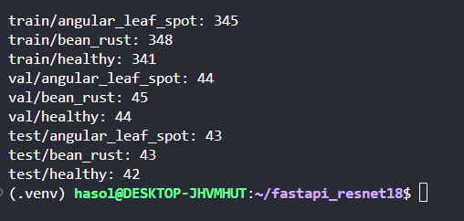
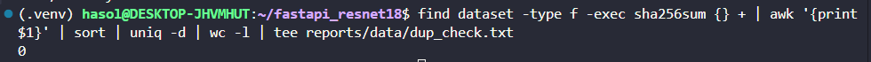

## 2. 실행 설정

| 파라미터 | 값 |
|---|---|
| base_model | microsoft/resnet-18 |
| epochs | 3 |
| batch_size | 8 |
| learning_rate | 0.0002 (제공 코드 기본값) |
| freeze_backbone | True |
| output | artifacts/beans_resnet18 |
| seed | 42 (제공 코드) |
| 장치 | CPU |
| 실행 위치 | WSL2 Ubuntu `.venv` (Docker `trainer`는 사용하지 않음) |

실행 명령 (제공 코드 실행 옵션만 사용):

```bash
python -m training.finetune --data dataset --output artifacts/beans_resnet18 --epochs 3 --batch-size 8 --freeze-backbone
```

## 3. 학습 결과

| Epoch | Train Loss | Validation Loss | Validation Accuracy |
|---:|---:|---:|---:|
| 1 | 0.9924 | 0.8379 | 0.6617 |
| 2 | 0.8108 | 0.6868 | 0.7669 |
| 3 | 0.7078 | 0.5911 | 0.7669 |

- Validation Loss는 제공 코드가 출력하지 않아 `reports/val_loss_log.py`로 같은 seed·설정을 재현해 기록 (train loss·val accuracy 일치 확인)

- Best Validation Accuracy: **0.7669** (133장 중 102장)
- Best 모델 저장: `artifacts/beans_resnet18/` — **epoch 2 시점 가중치**
  (제공 코드는 Validation Accuracy가 이전보다 *높을 때만* 저장하므로, 같은 값인 epoch 3은 저장되지 않음)
- Test: 기준선은 측정하지 않음 — 최종 모델(7장)만 1회 측정 (아래 3-1)
- 해석: 3 epoch 동안 loss가 계속 감소하고 있어 아직 충분히 학습되지 않은 상태로 판단됨

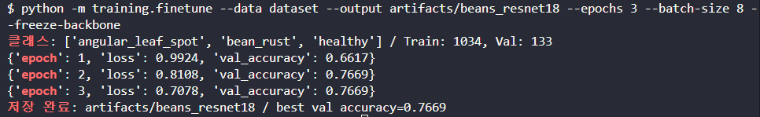

## 3-1. 최종 모델 Test 평가 (reports/evaluate.py, 1회 측정)

- 대상: 7장에서 Validation으로 선택한 최종 모델 `artifacts/beans_resnet18_lr5e4` (lr 0.0005)
- 제공 학습 코드에는 Test 평가가 없어 별도 평가 스크립트(`reports/evaluate.py`, 제공 코드 수정 아님)로 측정
- 순서: 개선 실험 → Validation으로 최종 모델 선택 → **선택한 모델만 Test 1회** (Test 결과로 설정을 바꾸지 않음)

| split | 정확도 | 맞힌 수 |
|---|---:|---:|
| train | 0.8066 | 834 / 1,034 |
| val | 0.8120 | 108 / 133 |
| **test** | **0.7891** | **101 / 128** |

**Test 클래스별 지표**

| 클래스 | precision | recall | f1 | 정답/전체 |
|---|---:|---:|---:|---:|
| angular_leaf_spot | 0.6269 | 0.9767 | 0.7636 | 42 / 43 |
| bean_rust | 0.9524 | **0.4651** | 0.6250 | 20 / 43 |
| healthy | 0.9750 | 0.9286 | 0.9512 | 39 / 42 |

**Test 혼동행렬** (행 = 정답, 열 = 예측)

| 정답 \ 예측 | angular_leaf_spot | bean_rust | healthy |
|---|---:|---:|---:|
| angular_leaf_spot | **42** | 0 | 1 |
| bean_rust | 23 | **20** | 0 |
| healthy | 2 | 1 | **39** |

**해석**
- train 0.8066 / val 0.8120 / test 0.7891 → train−val 차이 −0.0054로 **과적합 징후 없음**, 세 값이 모두 0.8 안팎이라 여전히 학습 여지가 있는 상태
- **병든 잎을 정상으로 판단한 경우: 86장 중 1장** (반점병 → 정상 1) → 현장에서 가장 위험한 "병 놓침" 오류는 적음
- 가장 큰 약점: **녹병 43장 중 23장을 반점병으로 혼동** (bean_rust recall 0.4651). 두 병 모두 잎에 반점이 생겨 Head-only(분류층만 학습)로는 구분 특징이 부족한 것으로 판단 → 8장 다음 단계(Full Fine-tuning)와 08 보고서 OpenCV 제안의 근거
- 반점병 precision 0.6269: "반점병"으로 예측한 67장 중 25장이 실제로는 다른 클래스(대부분 녹병)

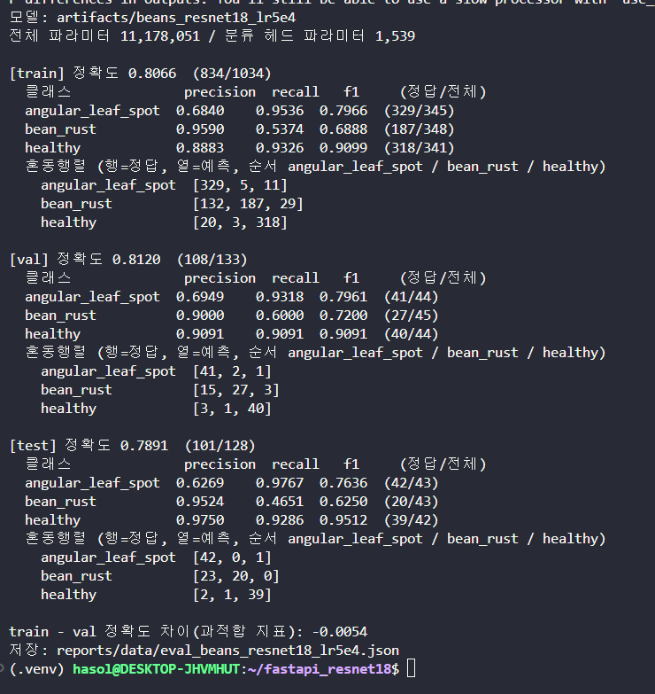

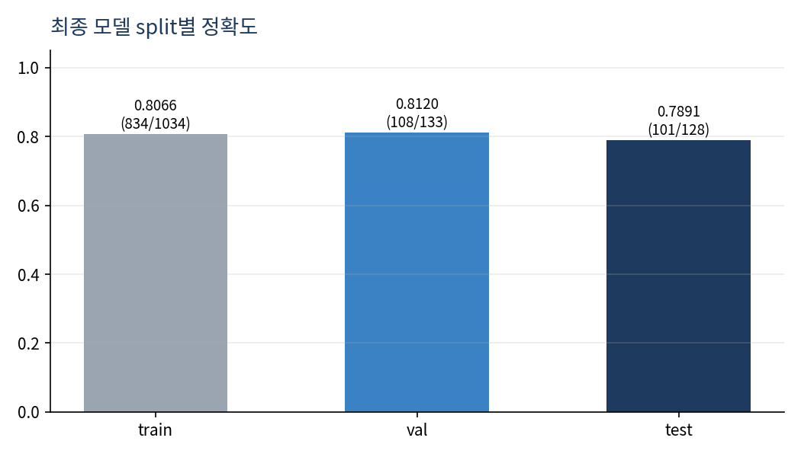

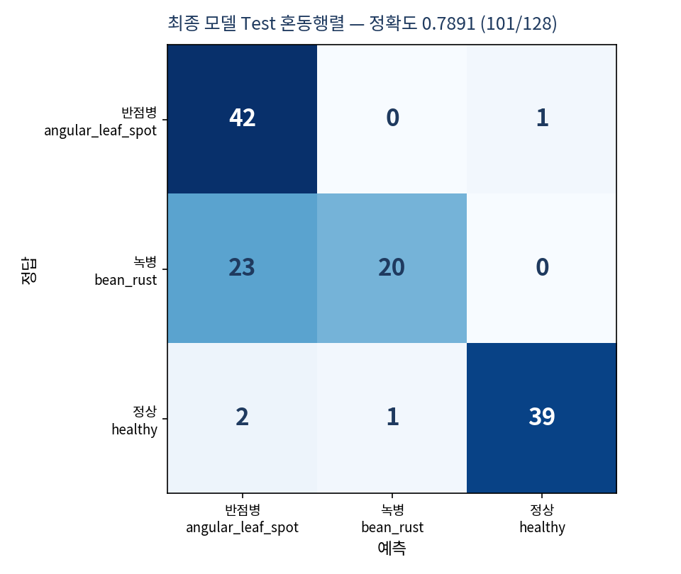

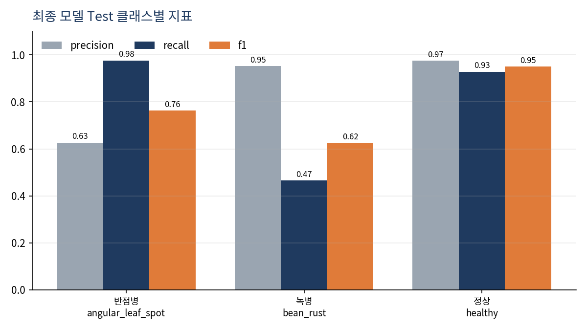

## 4. 생성 파일 확인

- [x] config.json
- [x] model.safetensors (44,766,388 bytes)
- [x] preprocessor_config.json
- [x] training_report.json

`training_report.json` 원본:

```json
{
  "base_model": "microsoft/resnet-18",
  "classes": ["angular_leaf_spot", "bean_rust", "healthy"],
  "train_count": 1034,
  "val_count": 133,
  "best_val_accuracy": 0.7669172932330827,
  "history": [
    {"epoch": 1, "loss": 0.9924, "val_accuracy": 0.6617},
    {"epoch": 2, "loss": 0.8108, "val_accuracy": 0.7669},
    {"epoch": 3, "loss": 0.7078, "val_accuracy": 0.7669}
  ]
}
```

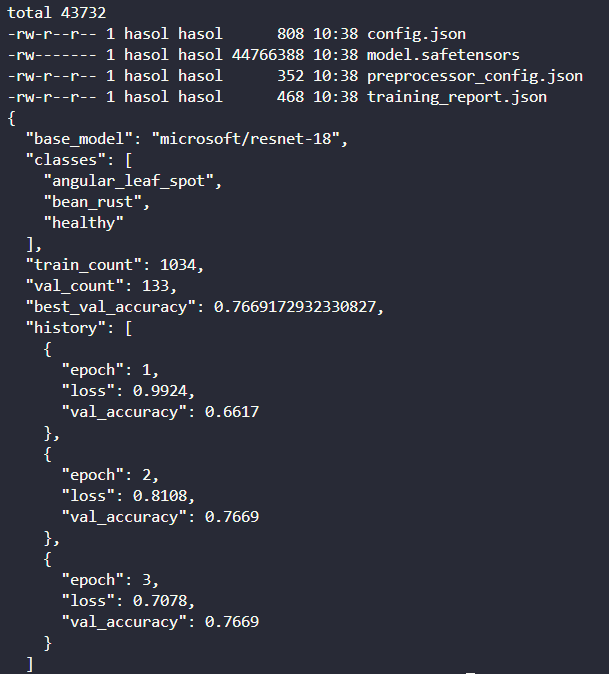

## 5. 서비스 연결 확인

- MODEL_PATH: `artifacts/beans_resnet18` (응답의 `model_id`로 확인)
- 동기 API(`POST /api/sync/classify/`) 결과 — Redis 캐시를 비운 뒤 test 폴더 샘플 각 1장 요청:

| 정답 폴더 | 파일 | HTTP | 예측 라벨 | 점수 | 정답 일치 |
|---|---|---:|---|---:|---|
| angular_leaf_spot | angular_leaf_spot_test.0.jpg | 200 | angular_leaf_spot | 0.4623 | O |
| bean_rust | bean_rust_test.0.jpg | 200 | bean_rust | 0.6051 | O |
| healthy | healthy_test.0.jpg | 200 | healthy | 0.6369 | O |

- 샘플 3장은 모두 정답 클래스로 분류됐으나, 최고 점수가 0.46~0.64로 확신도는 높지 않음
- 특히 `angular_leaf_spot` 샘플은 2위 `bean_rust`(0.3558)와 점수 차이가 작음
- 위 3장은 기준선 모델 시연용 샘플이며, Test 정확도는 3-1에서 최종 모델로 128장 전체를 평가한 결과(0.7891)를 기준으로 함

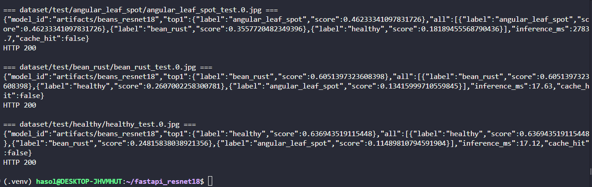

## 6. 결과 판정

- 완료: Head-only 기준선 학습·모델 저장, Validation Accuracy·Loss 기록, learning rate 개선 실험(0.7669 → 0.8120), 최종 모델 Test 1회(0.7891), 동기 API 3클래스 결과 반환 확인
- 한계:
  - 기준선은 train·val loss가 모두 감소 중이고(0.7078 / 0.5911) val accuracy 0.7669에 머묾 → 과적합이 아니라 **학습 부족** (7장에서 개선)
  - 최종 모델도 녹병을 반점병으로 혼동 (Test 녹병 43장 중 23장)
  - 예측 점수(확신도)가 낮은 편이며, 반점이 비슷한 `angular_leaf_spot`과 `bean_rust` 사이 혼동 가능성
  - 근사 중복 이미지 여부는 미확인
- 증빙: evidence/data_counts.png, evidence/dup_check.png, evidence/train_log.png, evidence/model_folder.png, evidence/api_sync_200.png, evidence/train_log_lr5e4.png, evidence/valloss_base.png, evidence/valloss_lr5e4.png, evidence/eval_final.png, evidence/ui_sync_final.png, evidence/ui_async_final.png

## 7. 개선 실험: learning rate 하나만 변경

### 7-1. 실험 이유
- 기준선 train loss 0.9924 → 0.7078, val loss 0.8379 → 0.5911로 **둘 다 감소 중** (val loss 상승 없음) → 과적합이 아니라 **학습 부족**
- 3 epoch 동안 train loss가 0.9924 → 0.8108 → 0.7078로 **출렁임 없이 천천히** 감소 → 한 번에 고치는 크기(learning rate)가 작다고 판단
- Head-only는 새로 초기화된 분류층(1,539개)만 학습하므로 learning rate를 키워도 사전학습 특징을 망가뜨릴 위험이 작음

### 7-2. 실험 설계
- 바꾼 것: `--lr` **하나만** (0.0002 → 0.0005 / 0.001)
- 고정: epochs 3, batch size 8, `--freeze-backbone`, seed 42, 같은 train 1,034 / val 133
- 제공 코드 수정 없음 (실행 옵션만 변경), 결과는 별도 폴더에 저장해 기준선을 덮어쓰지 않음
- **모델 선택은 Validation만 사용**, Test는 선택한 최종 모델에만 1회

```bash
python -m training.finetune --data dataset --output artifacts/beans_resnet18_lr5e4 --epochs 3 --batch-size 8 --lr 0.0005 --freeze-backbone
python -m training.finetune --data dataset --output artifacts/beans_resnet18_lr1e3_e3 --epochs 3 --batch-size 8 --lr 0.001 --freeze-backbone
```

### 7-3. 결과 (Validation Accuracy, 학습 로그)

| 실험 | lr | epoch 1 | epoch 2 | epoch 3 | Best val | 저장 epoch |
|---|---:|---:|---:|---:|---:|---:|
| A. 기준선 | 0.0002 | 0.6617 | 0.7669 | 0.7669 | 0.7669 (102/133) | 2 |
| **B. 최종** | **0.0005** | 0.7444 | 0.7669 | **0.8120** | **0.8120 (108/133)** | 3 |
| C. 비교 | 0.001 | 0.8271 | 0.8045 | 0.7820 | 0.8271 (110/133) | 1 |

- 참고: 같은 조건에서 batch size만 4로 줄인 실험은 Best val 0.7519(100/133)로 기준선보다 낮아 제외

### 7-4. Train / Validation Loss (최종 모델 B)

| epoch | Train Loss | Validation Loss | Validation Accuracy |
|---:|---:|---:|---:|
| 1 | 0.9004 | 0.6605 | 0.7444 |
| 2 | 0.6669 | 0.5341 | 0.7669 |
| 3 | 0.5718 | **0.4542** | **0.8120** |

- 비교: 기준선(A) 3 epoch Validation Loss 0.5911 → 최종(B) **0.4542** (같은 3 epoch에서 더 낮음)

- Validation Loss는 제공 코드가 출력하지 않아 `reports/val_loss_log.py`(같은 seed·설정으로 학습을 재현하며 val loss만 추가 계산, 모델 저장 안 함)로 기록. 재현한 train loss·val accuracy가 학습 로그와 소수점까지 일치함을 확인
- train loss·val loss가 모두 매 epoch 감소 → **과적합 징후 없음**, 3 epoch 시점에도 감소 중
- val loss가 train loss보다 낮은 이유: train loss는 epoch 진행 중 평균(초반 미학습 상태 포함), val loss는 epoch 종료 후 측정

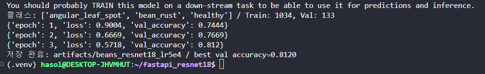

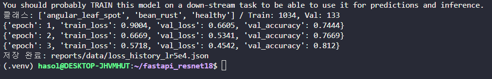

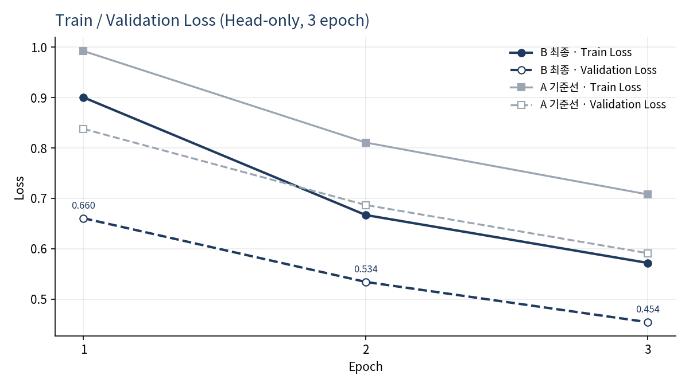

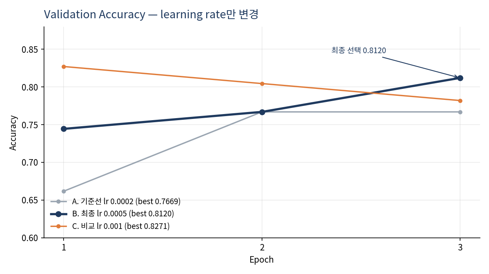

### 7-5. 최종 모델 선택 근거
- C(0.001)는 Best val이 0.8271로 가장 높지만 **epoch 1 이후 계속 하락**(0.8271 → 0.8045 → 0.7820) → 보폭이 커서 불안정
- B(0.0005)는 **매 epoch 꾸준히 상승**하고 마지막 epoch에 저장, train·val loss도 함께 감소
- B와 C의 차이는 val 133장 중 **2장(1.5%p)** → 차이가 작을 때는 더 안정적인 쪽을 선택한다는 기준으로 **B를 최종 모델로 선택**
- 기준선 대비: Validation 0.7669 → **0.8120 (+0.0451, 4.51%p)**, 같은 학습 시간(3 epoch)

### 7-6. 서비스 반영
- `.env`의 `MODEL_PATH=artifacts/beans_resnet18_lr5e4`로 변경 → `docker compose up -d --force-recreate web worker`
- 같은 ResNet18 구조·크기라 추론 속도에는 영향이 없으며, 서빙 검증·성능 측정(산출물 2~7)은 기준선 모델로 수행
- 교체 후 동기·비동기 화면 모두 응답 `model_id`가 `artifacts/beans_resnet18_lr5e4`로 바뀐 것을 확인 (validation 이미지 사용)

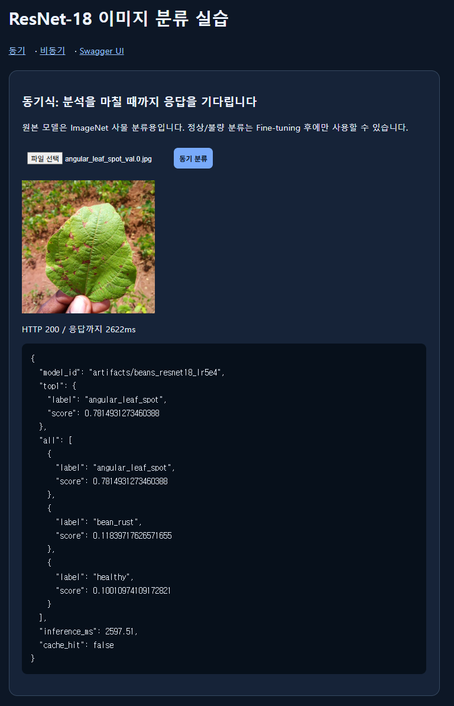

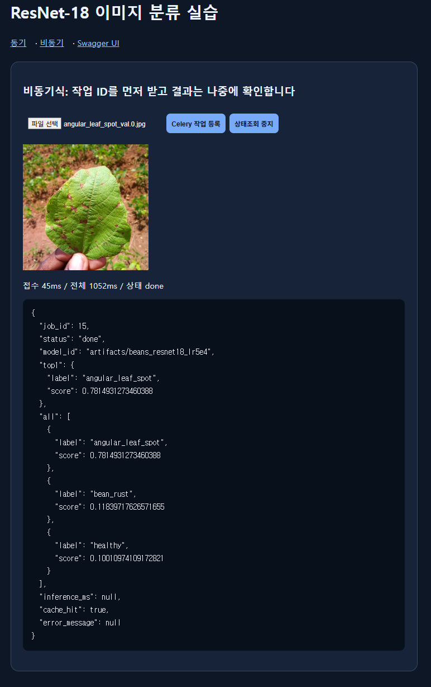

## 8. 다음 단계 제안 [미실시]
- **Full Fine-tuning** (가이드 6-1 B, `--freeze-backbone` 없이 낮은 lr, 별도 폴더 저장) → 같은 Validation으로 비교
- learning rate 0.0005에서 3 epoch 시점에도 loss가 감소 중 → 학습 기간 조정 검토
- 비교는 Validation으로 끝내고, Test는 최종 선택 모델에만 사용
