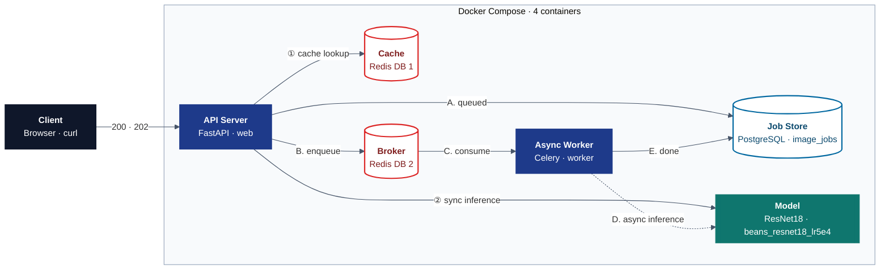
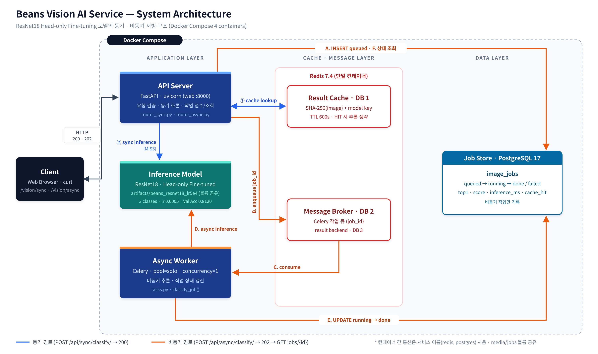
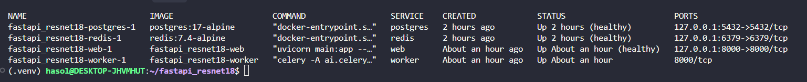
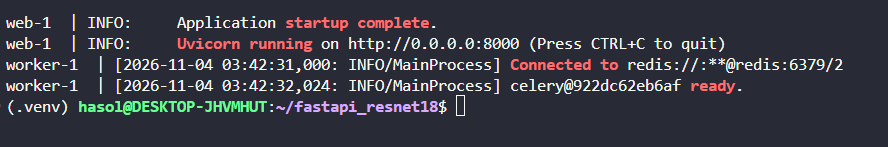

# 02. 전체 시스템 아키텍처

## 1. 구성도

PNG 버전: 

## 2. 컴포넌트 역할

| 컴포넌트 | 실행 위치 | 사용 파일 / 서비스 | 역할 |
|---|---|---|---|
| 브라우저 / curl | Windows 브라우저, WSL 터미널 | `templates/sync.html`, `templates/async.html` | 파일 업로드, 결과 표시 |
| FastAPI (web) | Docker 컨테이너 `web` | `main.py`, `ai/router_sync.py`, `ai/router_async.py`, `ai/router_web.py` | HTTP 요청 검증·응답, 동기 추론, 비동기 작업 접수·조회 |
| ResNet18 모델 | web·worker **각 프로세스에 별도 로드** | `ai/hf_model.py`, `artifacts/beans_resnet18_lr5e4/` (최종) | 콩잎 3클래스 분류 |
| Redis Cache | Docker `redis` DB 1 | `ai/cache_service.py` | 같은 이미지·같은 모델 결과 600초 재사용 |
| Redis Broker | Docker `redis` DB 2 (결과 백엔드 DB 3) | `ai/celery_app.py` | FastAPI → Celery 작업 전달 |
| PostgreSQL | Docker `postgres` | `ai/database.py`, `ai/models.py` | 비동기 작업 상태·결과 기록 (`image_jobs`) |
| Celery Worker | Docker 컨테이너 `worker` | `ai/tasks.py` | 비동기 추론·DB 갱신 |
| 학습 | WSL2 `.venv` (Docker `trainer` 미사용) | `training/finetune.py` | Head-only Fine-tuning → `artifacts/` 생성 |

- web과 worker는 **같은 Docker 이미지**(Dockerfile)로 만든 서로 다른 컨테이너
- `./artifacts`, `./media/jobs`를 web·worker가 **볼륨으로 공유** → 같은 모델, 같은 업로드 파일 사용
- 컨테이너 안에서는 `localhost`가 아니라 **서비스 이름**(`redis`, `postgres`)으로 접속
  - 근거: worker 로그 `Connected to redis://**@redis:6379/2` ([docker_logs.png](evidence/docker_logs.png))

## 3. 실행 환경 (실제 확인값)

| 항목 | 값 |
|---|---|
| OS | Windows + WSL2 Ubuntu 26.04.1 LTS |
| CPU / RAM | 20 논리 코어 / 15 GiB (GPU 미사용, CPU 추론) |
| Docker / Compose | Docker 29.9.2 / Compose v5.6.1 |
| 컨테이너 Python | 3.11 (`python:3.11-slim`, CPU 전용 torch 2.5.1) |
| 호스트 Python (학습·측정) | 3.14.4 (.venv) |
| Docker 서비스 | redis(7.4-alpine), postgres(17-alpine), web, worker |
| 서버 프로세스 | `uvicorn main:app --host 0.0.0.0 --port 8000` (web) |
| 워커 프로세스 | `celery -A ai.celery_app:celery_app worker --pool=solo --concurrency=1` |
| 모델 경로 | `MODEL_PATH=artifacts/beans_resnet18_lr5e4` (`.env`, 최종 모델) — 서빙 검증 캡처는 기준선 `artifacts/beans_resnet18`로 수행 |

실행 근거: [docker_ps.png](evidence/docker_ps.png) — 4개 컨테이너 Up, web `(healthy)`

## 4. 구조 검증 결과

- **동기**: 브라우저 → FastAPI(web) → Redis Cache(MISS) → ResNet18 → FastAPI → 브라우저 (HTTP 200)
- **비동기**: 브라우저 → FastAPI(web) → `media/jobs` 저장 → PostgreSQL(queued) → Redis Broker → Worker → PostgreSQL(done) → 브라우저 조회
- 동기 요청 결과는 기본 코드에서 `image_jobs`에 저장하지 않음 (동기 3건 실행 후 DB 행은 비동기 job만 존재)
- 모델은 web·worker가 각각 첫 요청 때 따로 로드 → 각 프로세스 첫 요청이 느림 (web 2783.7ms, worker 2555.81ms)

