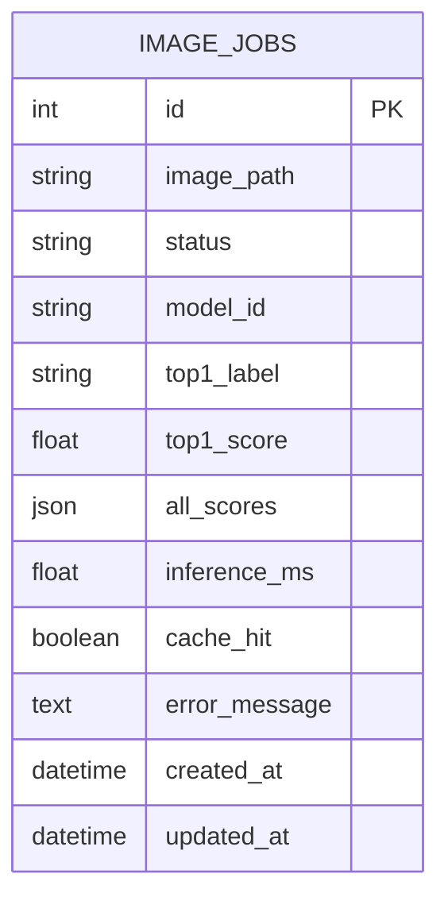
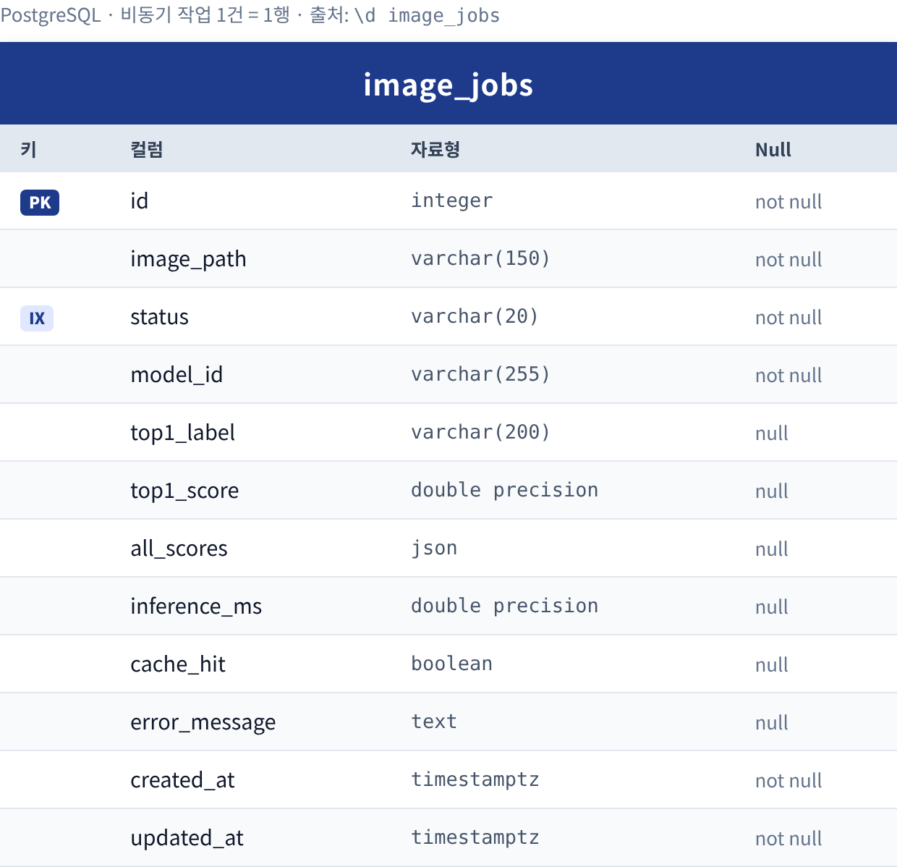
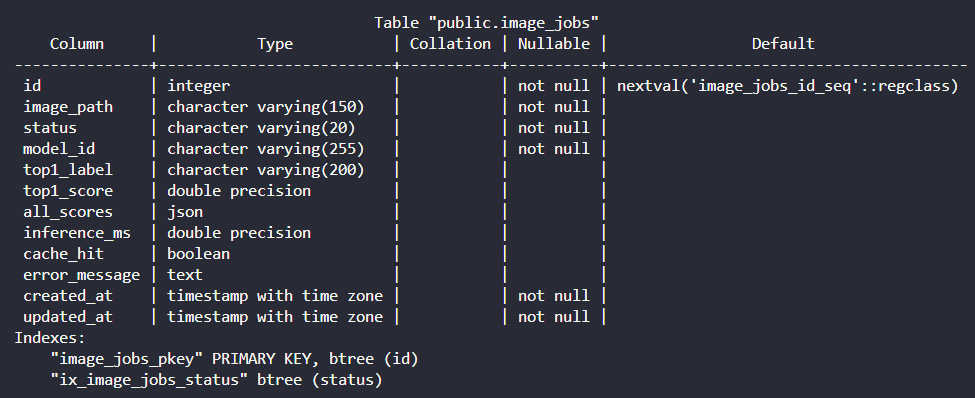
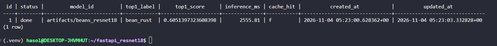

# 04. 데이터베이스 구조 및 작업이력

**테이블명:** `image_jobs` · **PK:** `id` · **저장 대상:** 비동기 추론의 작업 상태 및 결과
**DB:** PostgreSQL 17 (Docker `postgres`) · **정의 파일:** `ai/models.py` · **생성:** FastAPI 시작 시 `init_db()`

## 1. ERD



PNG 버전: 

## 2. 컬럼 정의 (실제 `\d image_jobs` 결과 기준)

| 컬럼 | DB 자료형 | Nullable | 기본값 (설정 위치) | 실제 값 예 (job 1) | 사용 이유 |
|---|---|---|---|---|---|
| id | integer | not null | `nextval(...)` (DB) | 1 | 고유 작업번호 |
| image_path | varchar(150) | not null | — | `<uuid>.bin` | `media/jobs/` 파일 찾기 |
| status | varchar(20) | not null | `queued` (**Python**) | done | 처리 상태 |
| model_id | varchar(255) | not null | `""` (**Python**) | artifacts/beans_resnet18 | 사용 모델 식별 |
| top1_label | varchar(200) | null | — | bean_rust | 최종 분류 라벨 |
| top1_score | double precision | null | — | 0.6051397323608398 | 분류 점수 |
| all_scores | json | null | — | 3클래스 점수 목록 | 전체 점수 |
| inference_ms | double precision | null | — | 2555.81 | 실제 추론시간 (HIT면 null) |
| cache_hit | boolean | null | — | false | 캐시 재사용 여부 |
| error_message | text | null | — | null | 실패 원인 |
| created_at | timestamptz | not null | UTC 현재시각 (**Python**) | 2026-11-04 05:23:00.628 | 생성 시점 |
| updated_at | timestamptz | not null | UTC 현재시각, 갱신 시 자동 (**Python**) | 2026-11-04 05:23:03.333 | 갱신 시점 |

- 인덱스: `image_jobs_pkey` (PK, id), `ix_image_jobs_status` (status)
- `status`, `model_id`, `created_at`, `updated_at`의 기본값은 **DB가 아니라 SQLAlchemy(`models.py`)가 INSERT 시 넣음** → `\d image_jobs`의 Default 칸이 비어 있음



## 3. SQL 조회

```sql
SELECT id, status, model_id, top1_label, top1_score, inference_ms, cache_hit, created_at, updated_at
FROM image_jobs
ORDER BY id DESC
LIMIT 10;
```

실행 명령: `docker compose exec postgres psql -U vision_user -d vision_db -c "..."`

## 4. 조회 결과 기록 (실제)

| id | status | top1_label | top1_score | inference_ms | cache_hit | 판정 |
|---:|---|---|---:|---:|---|---|
| 1 | done | bean_rust | 0.6051 | 2555.81 | false | 비동기 추론 완료 (worker 첫 작업, 모델 로딩 포함) |



이후 실행에서 생성된 작업 (API 응답으로 확인):

| job_id | 생성 경위 | 최종 status | cache_hit | 비고 |
|---:|---|---|---|---|
| 2 | 브라우저 `/vision/async/` (healthy_test.0.jpg) | done | false | inference_ms 20.83 |
| 3 | 성능 측정 워밍업 | done | — | 측정 제외 |
| 4~8 | 성능 측정 비동기 MISS 5회 | done | false | |
| 9~13 | 성능 측정 비동기 HIT 5회 | done | true | inference_ms null |
| 14 | T-10 Worker 중지 테스트 | queued → done | true | worker 재시작 후 처리 |

## 5. 상태 전이

```
queued (FastAPI가 행 생성) → running (worker 시작) → done (결과 저장)
                                                 └→ failed (예외 발생 시 error_message 저장)
```

**실제 시간 흐름 (job 1)**

| 시각 (UTC) | 이벤트 | 근거 |
|---|---|---|
| 05:23:00.628 | `queued` 행 생성 | `created_at` |
| 05:23:00.672 | worker 작업 수신 | Celery 로그 `received` |
| 05:23:03.336 | worker 처리 완료 | Celery 로그 `succeeded in 2.66s` |
| 05:23:03.333 | `done` 기록 | `updated_at` |

- `running`은 처리 시간이 짧아 조회로 직접 보지 못함 → 최종 결과·DB·로그로 정상 완료 판단 (평가가이드 STEP 3)
- **failed 행: 미발생** (실환경에서 실패 작업 없음, 모의 테스트에서만 failed 기록 확인)

## 6. 저장 방식 정리

- 이미지 원본: `media/jobs/<uuid>.bin` (사용자 파일명은 사용하지 않음), DB에는 파일명만 저장
- 동기 요청: 기본 제공 코드에서는 `image_jobs`에 **행을 생성하지 않음**
- 테이블은 1개이며 FK·관계 테이블 없음
