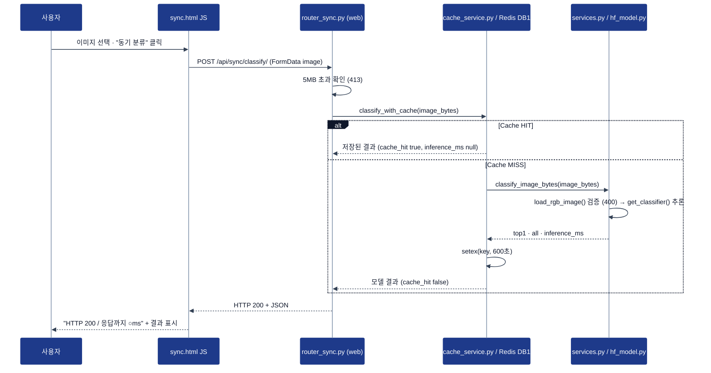
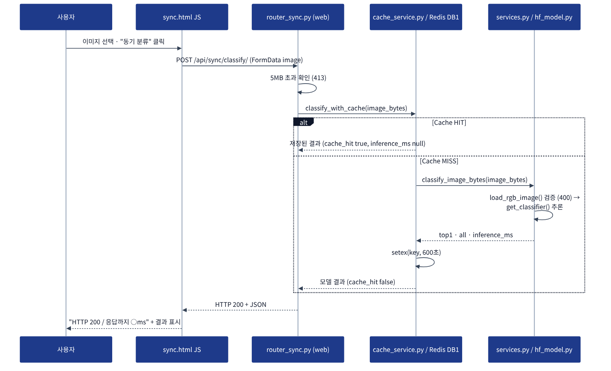
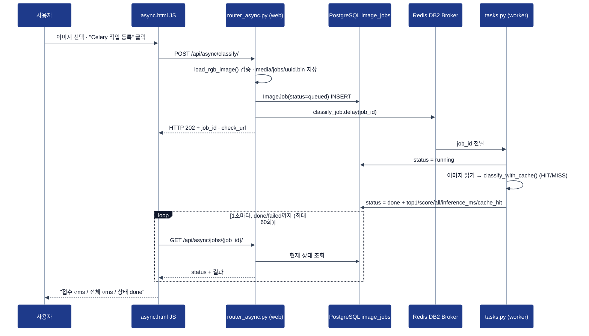
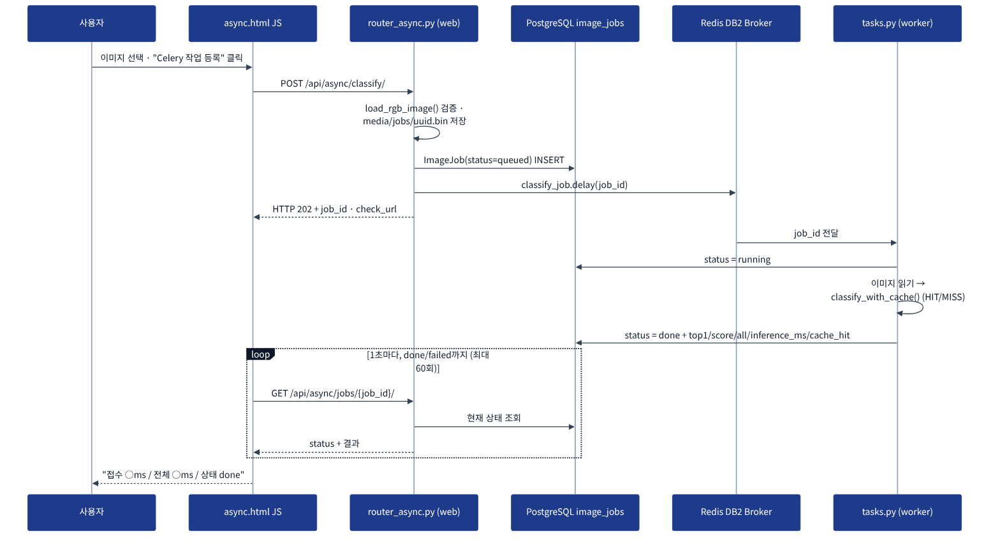

# 05. AI 분석 버튼 처리 파이프라인

## A. 동기 버튼 클릭 시퀀스

PNG 버전: 

## B. 비동기 버튼 클릭 시퀀스

PNG 버전: 

## C. 실제 코드 연결표

| 단계 | 파일 | 핵심 함수·처리 | 반환 / 다음 단계 |
|---|---|---|---|
| 동기 1 | `templates/sync.html` | `fetch('/api/sync/classify/')` | POST 요청 |
| 동기 2 | `ai/router_sync.py` | `classify_sync()` — 5MB 확인 | `classify_with_cache()` |
| 동기 3 | `ai/cache_service.py` | `classify_with_cache()` — `cache_key()`로 Redis 조회 | HIT → 저장값 / MISS → `classify_image_bytes()` |
| 동기 4 | `ai/services.py` | `load_rgb_image()` 검증, `get_classifier()(image, top_k=5)` | `model_id`, `top1`, `all`, `inference_ms` |
| 동기 5 | `ai/hf_model.py` | `get_classifier()` — `@lru_cache`로 프로세스당 1회 로드 | transformers pipeline |
| 비동기 1 | `templates/async.html` | `fetch('/api/async/classify/')` | POST 요청 |
| 비동기 2 | `ai/router_async.py` | `enqueue_classify()` — 검증·파일 저장·DB queued·`delay()` | 202 + job_id |
| 비동기 3 | `ai/tasks.py` | `classify_job()` — running → `classify_with_cache()` → done / failed | DB 갱신 |
| 비동기 4 | `templates/async.html` | 1초 간격 폴링 (`sleep(1000)`) | GET 상태 조회 |
| 비동기 5 | `ai/router_async.py` | `get_job()` | status + 결과 JSON / 404 |

## D. 실제 실행 확인

| 구분 | 화면 결과 | 증빙 |
|---|---|---|
| 동기 (angular_leaf_spot_test.0.jpg) | HTTP 200 / 응답까지 54ms, top1 angular_leaf_spot 0.4623, inference 33.45ms | [ui_sync.png](evidence/ui_sync.png) |
| 비동기 (healthy_test.0.jpg) | 접수 24ms / 전체 1043ms / 상태 done, job 2, top1 healthy 0.6369, inference 20.83ms | [ui_async.png](evidence/ui_async.png) |
| Worker 처리 로그 | `Task ai.classify_job[...] received` → `succeeded in 2.66s: {'job_id': 1, 'status': 'done'}` | [celery_log.png](evidence/celery_log.png) |

## E. 비교 결론

- 동기: HTTP 응답을 받을 때 추론 결과가 포함된다 (200)
- 비동기: HTTP 202로 접수 후 별도 조회가 필요하다. 화면의 전체 1043ms 중 실제 추론은 약 21ms이고, 나머지는 **1초 간격 폴링** 때문
- 분류를 수행하는 ResNet18 모델은 동일하다 → 같은 사진(bean_rust_test.0.jpg)의 동기·비동기 점수가 0.6051397323608398로 완전히 같음
