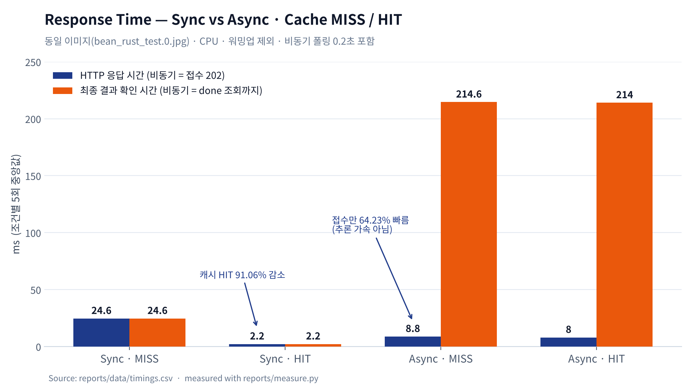
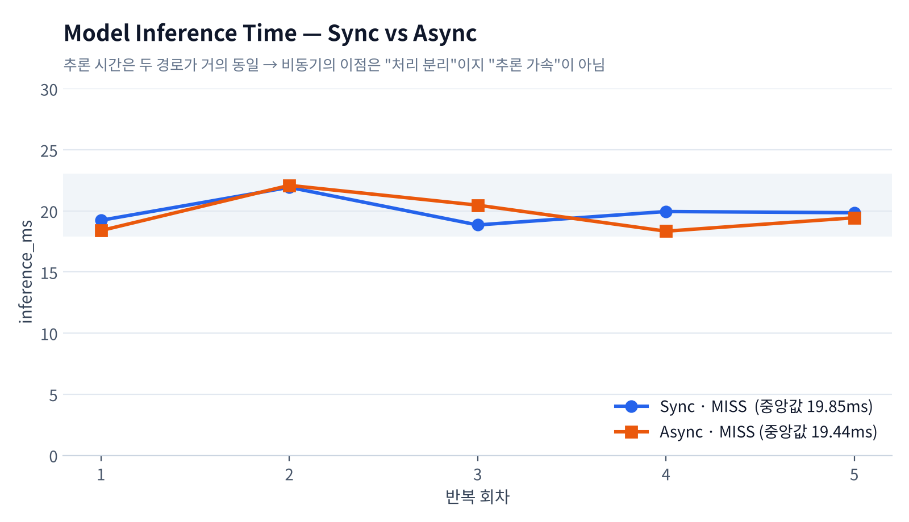
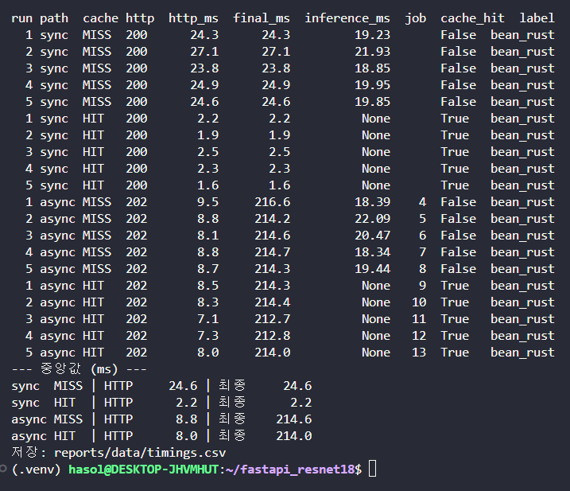

# 06. 성능 측정 및 비교 보고서

## 1. 실험 조건

| 조건 | 값 |
|---|---|
| 이미지 | `dataset/test/bean_rust/bean_rust_test.0.jpg` (모든 조건 동일 파일) |
| 모델 | `artifacts/beans_resnet18` (Head-only 기준선, epoch 2 체크포인트) — 최종 모델(lr5e4)은 같은 ResNet18 구조·크기 |
| 실행환경 | WSL2 Ubuntu 26.04.1, CPU 20 논리 코어, RAM 15 GiB, GPU 미사용 / Docker Compose (web·worker·redis·postgres) |
| Worker | `solo`, `concurrency=1` |
| 반복 | 조건별 5회, 요청은 1개씩 순차 전송 |
| 캐시 | MISS: 매 요청 전 Redis DB1 `FLUSHDB` / HIT: 캐시 저장 상태에서 요청 |
| 워밍업 | 동기 1회, 비동기 1회(job 3) 먼저 실행하고 기록 제외 |
| 측정 도구 | `reports/measure.py` (httpx + `time.perf_counter`, WSL 호스트에서 실행) — 제공 코드 수정 아님 |
| 비동기 최종시간 | POST 시작 ~ GET 조회에서 `done` 확인까지, **폴링 간격 0.2초 포함** |
| 측정 시각 | 2026-11-04 14:55 (KST) |

## 2. 원본 측정표 (ms)

| 반복 | Sync HTTP (MISS) | Sync HTTP (HIT) | Async 접수 HTTP (MISS) | Async 최종 (MISS) | Async 접수 HTTP (HIT) | Async 최종 (HIT) |
|---:|---:|---:|---:|---:|---:|---:|
| 1 | 24.3 | 2.2 | 9.5 | 216.6 | 8.5 | 214.3 |
| 2 | 27.1 | 1.9 | 8.8 | 214.2 | 8.3 | 214.4 |
| 3 | 23.8 | 2.5 | 8.1 | 214.6 | 7.1 | 212.7 |
| 4 | 24.9 | 2.3 | 8.8 | 214.7 | 7.3 | 212.8 |
| 5 | 24.6 | 1.6 | 8.7 | 214.3 | 8.0 | 214.0 |
| **중앙값** | **24.6** | **2.2** | **8.8** | **214.6** | **8.0** | **214.0** |

모델 추론시간 `inference_ms` (MISS, 중앙값): 동기 **19.85** / 비동기 **19.44** · HIT은 모두 `null`
원본: [timings.csv](data/timings.csv) · 20건 모두 top1 `bean_rust`

## 3. 계산

```text
HTTP 응답시간 감소율 (MISS) = (24.6 - 8.8) / 24.6 × 100 = 64.23%  (비동기 접수가 더 빠름)
최종 결과 확인시간 차이 (MISS) = 214.6 - 24.6 = 190.0 ms            (비동기가 더 느림)
동기 캐시 효과 = (24.6 - 2.2) / 24.6 × 100 = 91.06% 감소
```

## 4. 캐시 비교표 (중앙값)

| 경로 | 캐시 | HTTP 응답(ms) | 최종 확인(ms) | 추론시간(ms) | 메모 |
|---|---|---:|---:|---:|---|
| 동기 | MISS | 24.6 | 24.6 | 19.85 | 모델 실제 추론 |
| 동기 | HIT | 2.2 | 2.2 | null | 추론 생략, Redis 조회만 |
| 비동기 | MISS | 8.8 (접수) | 214.6 | 19.44 | worker 추론 |
| 비동기 | HIT | 8.0 (접수) | 214.0 | null | worker가 캐시 결과 사용 |

## 4-1. 비교 그래프





## 5. 해석

- 비동기 접수 HTTP 응답은 동기 결과 응답보다 **64.23% 빠르게** 반환됐다.
- 이 수치는 **모델 추론이 빨라졌다는 뜻이 아니다.** 추론시간 중앙값은 동기 19.85ms, 비동기 19.44ms로 거의 같다. 작업 접수와 실제 처리를 분리한 효과다.
- 최종 결과 확인은 비동기가 **190ms 더 느렸다.** 실제 추론은 약 20ms인데 최종시간이 약 214ms인 것은 큐 전달과 **0.2초 폴링 간격** 때문이다 (첫 조회가 약 0.2초 후).
- 동기에서는 캐시 HIT 시 응답이 24.6 → 2.2ms로 **91.06% 감소**했다.
- 비동기에서는 MISS·HIT 최종시간이 214.6 vs 214.0ms로 거의 같다 → 추론시간(약 20ms) 차이가 **폴링 간격(200ms)에 가려져** 보이지 않는다.
- Cache HIT의 `inference_ms=null`은 추론을 생략했다는 뜻이며 0ms가 아니다.

**참고: 워밍업(첫 요청) 값 — 비교에서 제외**
- web 첫 동기 요청: inference_ms 2783.7 / worker 첫 비동기 작업(job 1): 2555.81
- 원인: web·worker가 각각 첫 요청 때 모델을 로드 (`hf_model.py` `@lru_cache`)

**참고: 브라우저 화면 측정 (폴링 1초)**
- `/vision/sync/`: HTTP 200 / 응답까지 54ms
- `/vision/async/`: 접수 24ms / 전체 1043ms → 화면 폴링 간격이 1초라 최종시간이 1초 이상

## 6. 비교 조건 점검

- [x] 같은 모델 체크포인트로 측정
- [x] MISS 대 MISS, HIT 대 HIT 구분
- [x] 같은 이미지·하드웨어·조건
- [x] 모델 첫 로딩·워밍업 제외 표기
- [x] 반복 원본값과 요약표 일치 (timings.csv)

## 7. 한계

- 사진 1장, CPU, 요청을 하나씩 보낸 조건 → **동시 요청이 많을 때의 성능은 측정하지 않음**
- 비동기 최종시간은 폴링 간격(측정 0.2초, 화면 1초)에 크게 좌우됨


