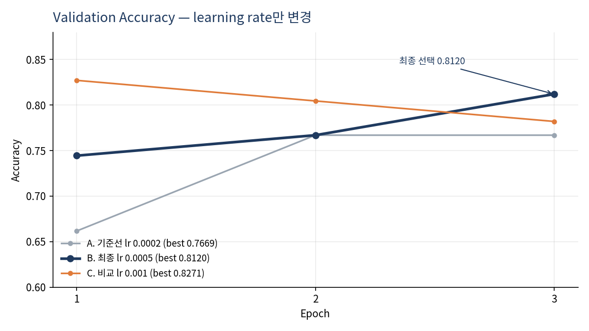
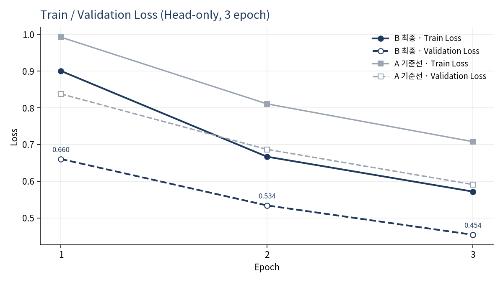
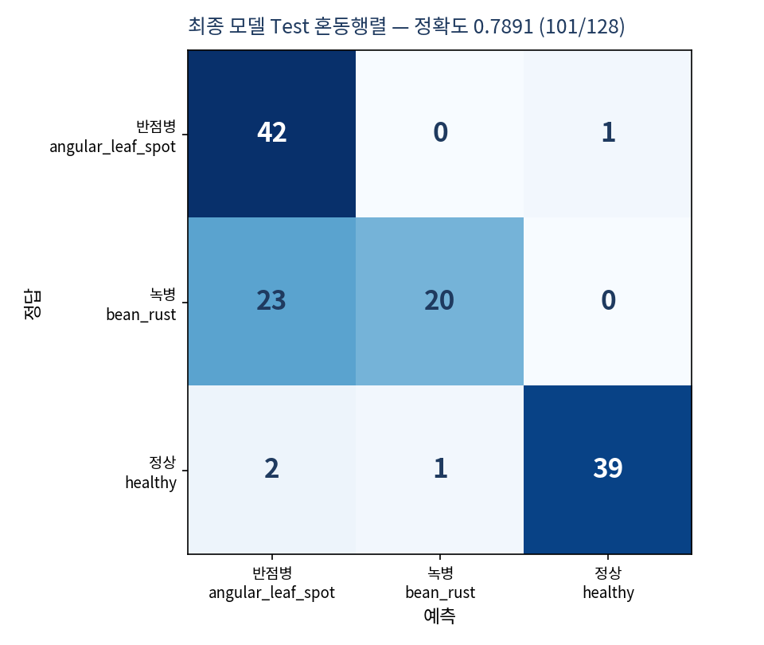
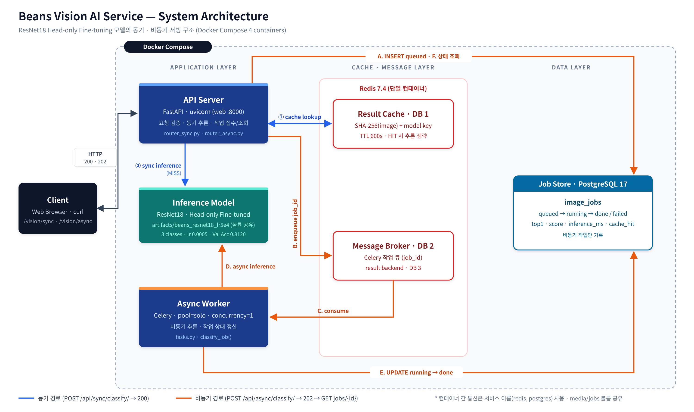
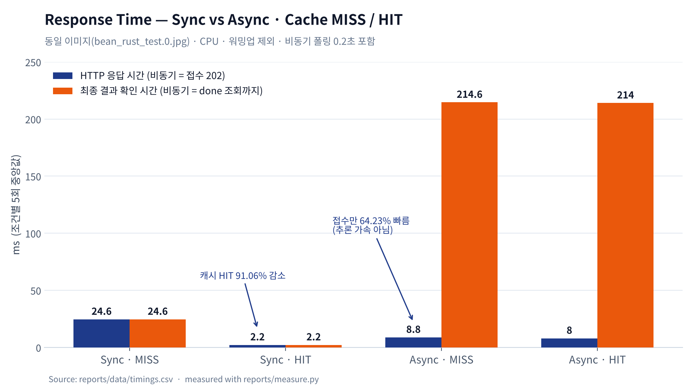

# 콩잎 질병 분류 Vision AI 서비스 — 최종 기술보고서

| 항목 | 내용 |
|---|---|
| 프로젝트 | ResNet18 기반 콩잎 3클래스 분류 및 FastAPI 동기·비동기 서빙 |
| 입력 / 출력 | JPEG · PNG · WEBP (5MB 이하) / `angular_leaf_spot` · `bean_rust` · `healthy` |
| 최종 모델 | `microsoft/resnet-18` → Head-only Fine-tuning (lr 0.0005) → `artifacts/beans_resnet18_lr5e4` |
| 실행 구조 | Docker Compose — web(FastAPI) · worker(Celery) · redis · postgres |
| 실행 환경 | Windows + WSL2 Ubuntu 26.04.1, CPU 20 논리 코어, RAM 15 GiB, GPU 미사용 |
| 작성일 | 2026-11-04 |

---

## 요약 (Executive Summary)

- **모델:** Head-only 기준선(Val 0.7669)을 진단한 결과 과적합이 아닌 학습 부족으로 판단했다. 다른 조건을 고정하고 learning rate 하나만 비교해 Val **0.8120**(+4.51%p) 모델을 선택했고, 최종 모델로 Test를 한 번 측정해 **0.7891**(101/128)을 얻었다.
- **현장 관점 품질:** 병든 잎을 정상으로 놓친 경우는 **86장 중 1장**이다. 가장 큰 약점은 **녹병을 반점병으로 혼동(23/43)**하는 것이다.
- **서빙:** 동기 API는 캐시 HIT 시 응답시간이 **91.06%** 줄었다(24.6 → 2.2 ms). 비동기는 접수 응답이 8.8 ms로 빠르지만 결과 확인까지 214.6 ms가 걸린다. 추론이 약 20 ms인 현재 조건에서는 **동기 방식이 적합**하다.
- **신뢰성:** worker를 중지한 상태에서 접수한 작업이 `queued`로 보존됐다가, 재시작 후 `done`으로 처리되는 것을 확인했다.
- **검증:** 실환경 통합 테스트 T-01~T-10 PASS, 모의 테스트 4 passed. 제공 코드는 수정하지 않았다.

---

## 1. 모델 개발

### 1-1. 데이터
| split | angular_leaf_spot | bean_rust | healthy | 합계 |
|---|---:|---:|---:|---:|
| train | 345 | 348 | 341 | 1,034 |
| val | 44 | 45 | 44 | 133 |
| test | 43 | 43 | 42 | 128 |

- 출처: Hugging Face `AI-Lab-Makerere/beans`, 라벨은 폴더 이름을 그대로 사용
- 누출 점검: split 간 SHA-256 **완전 중복 0건** (근사 중복은 미확인)
- 역할: train = 학습, val = epoch 저장과 모델 선택, test = 최종 모델 1회 평가

### 1-2. 기준선 (A) — Head-only Fine-tuning
- 설정: epochs 3, batch 8, lr 0.0002(기본값), `--freeze-backbone`, seed 42
- 학습 파라미터: 전체 11,178,051개 중 분류층 **1,539개 (0.014%)**

| Epoch | Train Loss | Val Loss | Val Acc |
|---:|---:|---:|---:|
| 1 | 0.9924 | 0.8379 | 0.6617 |
| 2 | 0.8108 | 0.6868 | 0.7669 |
| 3 | 0.7078 | 0.5911 | 0.7669 |

**진단:** 충분히 학습됐다면 loss가 평평해져야 하는데, 마지막 epoch까지 train·val loss가 계속 감소했다 → 더 배울 여지가 남은 **학습 부족**이다. val loss가 오르지 않아 과적합은 아니다.

**원인 후보:** learning rate가 작거나(업데이트 크기) epoch가 적은(학습 횟수) 경우 모두 같은 loss 모양이 나와 곡선만으로는 구분할 수 없다. 그래서 **같은 학습 시간(3 epoch)을 유지한 채 learning rate만 바꾸는 실험**으로 확인했고, epoch 조정은 다음 실험으로 남겼다.

### 1-3. 개선 실험 — learning rate 단일 변수 비교
- 변경: `--lr`만 변경 (0.0002 / 0.0005 / 0.001)
- 고정: epochs 3, batch 8, Head-only, seed 42, 동일 데이터 분할
- 원칙: **모델 선택은 Validation만 사용**, Test는 선택한 모델에 1회

| 실험 | lr | Val Acc (epoch 1 → 2 → 3) | Best Val | 판단 |
|---|---:|---|---:|---|
| A. 기준선 | 0.0002 | 0.6617 → 0.7669 → 0.7669 | 0.7669 | 학습 속도 느림 |
| **B. 최종** | **0.0005** | 0.7444 → 0.7669 → **0.8120** | **0.8120** | 꾸준히 상승 |
| C. 비교 | 0.001 | 0.8271 → 0.8045 → 0.7820 | 0.8271 | epoch 1 이후 하락, 불안정 |

- 같은 조건에서 batch size만 4로 바꾼 실험은 Best Val 0.7519로 기준선보다 낮아 제외했다.
- **선택 근거:** B와 C의 차이는 val 133장 중 2장(1.5%p)으로 흔들림 범위 안이다. 그래서 학습이 안정적이고(매 epoch 상승) train·val loss가 함께 감소한 **B를 최종 모델로 선택**했다.
- 최종 모델 Val Loss: 0.6605 → 0.5341 → **0.4542** (기준선 3 epoch 0.5911보다 낮음)

### 1-4. 최종 모델 Test 평가 (1회)
| split | Accuracy |
|---|---:|
| train | 0.8066 (834/1,034) |
| val | 0.8120 (108/133) |
| **test** | **0.7891 (101/128)** |

| 클래스 | Precision | Recall | F1 |
|---|---:|---:|---:|
| angular_leaf_spot | 0.6269 | 0.9767 | 0.7636 |
| bean_rust | 0.9524 | **0.4651** | 0.6250 |
| healthy | 0.9750 | 0.9286 | 0.9512 |

- train−val 차이 −0.0054 → **과적합 징후 없음**
- 병든 잎 → 정상 오판 **1/86**: 현장에서 가장 위험한 "병 놓침" 오류는 적다
- 녹병 → 반점병 혼동 **23/43**: 두 병 모두 잎에 반점이 생겨, 분류층만 학습하는 방식으로는 구분 특징이 부족한 것으로 판단

근거: [산출물 1](01_FineTuning_결과보고서.md) · `reports/data/train_log_*.txt` · `reports/data/loss_history_*.json` · `reports/data/eval_beans_resnet18_lr5e4.json`

---

## 2. 시스템 설계

| 구성요소 | 역할 | 비고 |
|---|---|---|
| FastAPI (web) | 요청 검증, 동기 추론, 비동기 작업 접수·조회 | 첫 요청 시 모델 로드 (`@lru_cache`) |
| Redis DB 1 | 결과 캐시 | 키 = SHA-256(이미지) + 모델, TTL 600초 |
| Redis DB 2 / 3 | Celery 브로커 / 결과 백엔드 | 컨테이너 간 접속은 서비스 이름(`redis`) 사용 |
| Celery worker | 비동기 추론, 작업 상태 갱신 | `pool=solo`, `concurrency=1` |
| PostgreSQL | `image_jobs` 작업 이력 | 비동기 작업만 기록 |

- **API:** `GET /health`, `POST /api/sync/classify/` (200), `POST /api/async/classify/` (202), `GET /api/async/jobs/{id}/` (200 / 404) — [산출물 3](03_API_명세서.md)
- **DB:** `image_jobs` 단일 테이블, 상태 `queued → running → done / failed` — [산출물 4](04_DB_구조_작업이력.md)
- **처리 흐름:** 동기·비동기 시퀀스와 코드 연결표 — [산출물 5](05_AI버튼_처리흐름.md)
- **모델 교체:** 코드 수정 없이 `.env`의 `MODEL_PATH` 변경 후 web·worker 재생성

---

## 3. 성능 비교

조건별 5회 중앙값, 워밍업 제외, 같은 이미지, 요청 1개씩 순차 전송, 비동기 폴링 0.2초

| 항목 | 동기 | 비동기 |
|---|---:|---:|
| HTTP 응답 (MISS) | 24.6 ms | **8.8 ms** (접수) |
| 최종 결과 확인 (MISS) | **24.6 ms** | 214.6 ms |
| HTTP 응답 (HIT) | **2.2 ms** | 8.0 ms (접수) |
| 모델 추론 (MISS) | 19.85 ms | 19.44 ms |

**해석**
- 비동기 접수가 64.23% 빠른 것은 **추론 가속이 아니라 접수와 처리를 분리한 효과**다. 추론시간은 두 경로가 같다.
- 비동기 최종 확인이 190 ms 느린 원인은 큐 전달과 폴링 간격이다.
- 동기 캐시 HIT는 추론을 생략해 응답이 91.06% 줄었다. HIT의 `inference_ms: null`은 0 ms가 아니라 추론을 생략했다는 뜻이다.
- 첫 요청은 프로세스별 모델 로딩으로 느리다 (web 2,783.7 ms / worker 2,555.81 ms).

근거: [산출물 6](06_성능비교_보고서.md) · [timings.csv](data/timings.csv)

---

## 4. 검증

| 구분 | 결과 |
|---|---|
| 실환경 통합 테스트 | T-01~T-10 **모두 PASS** (헬스, 동기·비동기, Redis·DB, 400·404, 캐시 HIT, worker 중지·재시작) |
| 모의 테스트 | `tests/test_api.py` **4 passed** (실환경 PASS와 분리 보고) |
| 미실시 | 5MB 초과(413) 실환경 업로드, 동시 요청 부하 |
| 오류 조치 | E-01 패키지 누락, E-02 로그 미저장, E-03 worker 중지 재현, E-04 pytest import 경로 |

근거: [산출물 7](07_기능테스트_오류분석.md)

---

## 5. 주요 의사결정

| 결정 | 근거 |
|---|---|
| Head-only를 기준선으로 사용 | 평가가이드 필수 실험. 학습 대상이 적어 결과를 빠르게 확인하고 진단하기 좋음 |
| 학습 부족으로 진단 | 마지막 epoch까지 train·val loss가 계속 감소(평평해지지 않음), val loss 상승 없음 |
| 개선 변수로 learning rate를 먼저 선택 | 원인 후보는 lr과 epoch 둘 다 가능하나 loss 곡선만으로 구분 불가. epoch는 학습 시간이 같이 늘어나므로, **같은 학습 시간 안에서** 더 잘 배우는지 먼저 확인. 분류층만 학습해 lr을 키워도 사전학습 특징 손상 위험 없음 |
| learning rate가 원인 중 하나라고 결론 | 다른 조건 고정, lr만 변경 → Val Acc 0.7669 → 0.8120, Val Loss 0.5911 → 0.4542 |
| epoch 조정은 다음 실험으로 | 최종 모델도 마지막 epoch까지 loss 감소 중 |
| 한 번에 한 변수만 변경 | 성능 변화의 원인을 특정하기 위해 |
| lr 0.0005 선택 (0.001 대신) | 최고 Val 차이가 2장(1.5%p)으로 작고, 0.001은 epoch 1 이후 계속 하락해 불안정 |
| Test는 최종 모델에만 1회 | Test로 모델을 고르면 성능이 낙관적으로 측정되므로 |
| 현재 조건에서 동기 방식 권장 | 추론 약 20 ms → 비동기의 큐·폴링 비용(약 190 ms)이 더 큼. 추론이 무겁거나 요청이 몰리면 비동기가 유리 |
| 모델 교체를 `.env`로 처리 | 제공 코드를 수정하지 않고 web·worker에 같은 모델을 일관되게 적용 |

---

## 6. 교과 9 OpenCV 개선 제안 [설계 제안 / 미구현]

**대상 문제:** 녹병 → 반점병 혼동 23/43. 두 병 모두 반점이 나타나므로 색·형태 특징으로 보조 판단할 여지가 있다.

| 제안 | 처리 흐름 | 기대 효과 | 주의점 |
|---|---|---|---|
| 1. HSV 병반 면적비 | RGB→HSV → 잎 마스크(`inRange`) → 황·갈색 병반 마스크 → Opening/Closing → 병반/잎 픽셀 비율 | 병반 정도를 수치화 | 조명·흙·그림자에 따라 임계값이 달라짐 |
| 2. 불확실 결과 보류 | top1 score가 낮거나 `healthy` 예측인데 병반 비율이 높으면 `확인 필요` (3클래스 결과는 유지) | 확신 없는 오분류를 사람이 재확인 | 보류율을 함께 보고해야 함 |
| 3. CNN 점수 + OpenCV 특징 ML | CNN 점수 + HSV 통계 + Contour 개수·면적 → Logistic Regression / RandomForest | 반점 형태 정보 추가 활용 | Train으로 학습, Val로 선택, Test는 마지막 1회 |
| 4. Grad-CAM 오류 분석 | 오분류 샘플에서 모델이 주목한 영역 확인 | 배경(흙) 의존 여부 점검 | 설명 도구일 뿐 정확도를 올리지 않음 |
| 5. 잎 ROI · GrabCut | 잎 영역만 남기고 배경 제거 → CNN 입력 후보 | 배경 의존성 감소 | 마스크 실패 시 정보 손실 |
| 6. ORB / SIFT 특징점 | 잎 ROI → 특징점·Descriptor → 반점 질감 비교 | 녹병(작은 갈색 점) vs 반점병(각진 반점) 질감 차이 탐색 | 촬영 각도·잎 모양 변화에 취약 |

- 구현 여부: **설계 제안만 제출**, 개선 수치는 주장하지 않음
- 모델 성능과 후처리 시스템 성능은 구현 시 분리해서 보고

---

## 7. 한계 및 향후 과제

**한계**
- 서빙 검증·성능 측정(산출물 2~7)은 기준선 모델로 수행했다. 최종 모델은 같은 ResNet18 구조·크기이므로, 교체 후에는 동기·비동기 동작만 확인했다.
- 개선 실험은 각 설정 1회 실행이다. val 133장 기준 1장 = 0.75%p라 작은 차이는 흔들림 범위다.
- 녹병 recall 0.4651 — 녹병 판정의 절반 이상을 반점병으로 혼동한다.
- 근사 중복 이미지, 동시 요청 부하, 5MB 초과(413) 실환경 업로드는 확인하지 않았다.

**향후 과제**
1. Full Fine-tuning(`--freeze-backbone` 제외, 낮은 lr, 별도 폴더) 비교 — 녹병·반점병 구분 특징 학습
2. epoch(학습 기간) 조정 — 이번에 lr과 함께 원인 후보였으나 남겨둔 변수. 최종 모델도 3 epoch 시점에 train·val loss가 감소 중
3. HSV 병반 면적 기반 `확인 필요` 보류 규칙 구현 및 보류율 측정
4. 동시 요청 부하 테스트로 비동기 구조의 이점 정량화

모든 비교는 Validation으로 끝내고, Test는 최종 선택 모델에만 사용한다.

---

## 8. 산출물 목록

| No. | 문서 | 확인 사항 |
|---|---|---|
| 01 | [Fine-tuning 결과보고서](01_FineTuning_결과보고서.md) | 데이터 분리, 학습·Loss 기록, 개선 실험, Test 평가 |
| 02 | [시스템 아키텍처](02_시스템_아키텍처.md) | 컨테이너 구성, 컴포넌트 역할 |
| 03 | [API 명세서](03_API_명세서.md) | 요청·응답 계약, 상태코드 |
| 04 | [DB 구조·작업이력](04_DB_구조_작업이력.md) | `image_jobs` 스키마, 상태 전이 |
| 05 | [AI 버튼 처리흐름](05_AI버튼_처리흐름.md) | 동기·비동기 시퀀스 |
| 06 | [성능비교 보고서](06_성능비교_보고서.md) | 응답·추론·캐시 시간 |
| 07 | [기능테스트·오류분석](07_기능테스트_오류분석.md) | 테스트 기록, 오류 조치 |
| — | [README](../README.md) | 재현 절차 |
